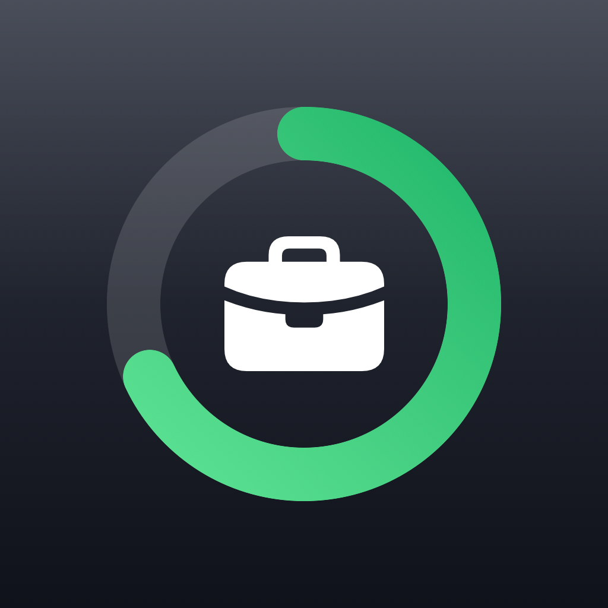

# 工作日 iOS 版

macOS 版 [workday-widget](../workday-widget) 的 iOS 对应版本：同一套排班算法，
展示在**下拉通知中心**、锁屏，以及主屏 / 锁屏小组件。

作者：**yefei.li** · © 2026 yefei.li



---

## iOS 上「消息中心常驻」的实现方式

iOS 的下拉通知中心**不支持第三方常驻组件** —— iOS 14 之后 Today View 小组件
就从通知中心移除了，通知中心只显示通知和实时活动。所以这里用两条路并行：

| 技术 | 出现位置 | 常驻性 |
| --- | --- | --- |
| **Live Activity**（ActivityKit） | 下拉通知中心、锁屏 | 需 App 启动；约 8 小时后变灰，最长 12 小时 |
| **WidgetKit 小组件** | 主屏、锁屏、今天视图 | 真正常驻，timeline 自动刷新，不需要 App 运行 |

Live Activity 负责你要的「下拉消息中心常驻」，小组件负责不受时长限制的长期显示。
两者共用 `Shared/` 下的同一套视图和算法。

### Live Activity 的时长限制怎么处理

- App 进入前台时自动启动 / 刷新（`autoStartLiveActivity`，默认开）。
- 工作时段内，卡片右下角用 `Text(timerInterval:)` 显示到下班的倒计时，
  这个由系统自己走，不依赖 App 更新。
- `staleDate` 设在下一个排班节点（上班 / 午休 / 晚餐 / 下班）之后一分钟，
  到点系统会把卡片变灰，而不是显示过期数字。
- 要做到完全不打开 App 也分钟级准确，需要 APNs 推送更新（要自建服务端）。
  小组件已经覆盖了「永远准确」的场景，所以这里没有引入服务端。

---

## 展示面

### Live Activity

- **通知中心 / 锁屏**：状态点 + 阶段、工作时段、整体大环、上午 / 下午小环、页脚。

灵动岛**刻意留空**，不展示任何内容。`ActivityConfiguration` 的 `dynamicIsland`
参数是必填的，ActivityKit 也没有关闭开关，所以所有区域都返回 `EmptyView()`
（见 `Widget/WorkdayLiveActivity.swift`）。

两个平台带来的残留行为：

- 实时活动活跃期间，系统仍会给灵动岛分配加宽的胶囊，所以药丸比完全没有活动时略宽。
  这个宽度不由内容决定，从 App 侧收不回来。
- 长按灵动岛会展开一块**空的黑面板**。活动存在就可展开，同样无法禁用。

### WidgetKit 小组件

| 尺寸 | 内容 |
| --- | --- |
| `systemSmall` | 阶段 + 整体大环 + 已工作时长 |
| `systemMedium` | 整体环 + 上午 / 下午两行 + 页脚（含 `yefei.li` 水印） |
| `accessoryCircular` | 锁屏圆形 Gauge |
| `accessoryRectangular` | 阶段 + 线性进度 + 文案 |
| `accessoryInline` | 一行文字 |

小组件 timeline 以 **2 分钟**为粒度预渲染未来 3 小时（约 90 条），
到期后 `.atEnd` 续期。8 小时工作日下每步约 0.4%，看起来是连续的。

### App 本体

- 首页：大号进度卡、实时活动开关、排班摘要、作者水印。
- 设置：上下班 / 午休 / 晚餐时间、自动启动实时活动、恢复默认、关于。

---

## 与 macOS 版的一致性

`Shared/WorkdayCore.swift` 是 macOS 版 `Sources/Model.swift` 里排班算法的同构实现
（去掉 macOS 专属的窗口开关）。两边输出已逐点比对：

```
17 个时间点（09:00 / 09:30 / 10:45 / 12:00 / 12:30 / 13:00 / 15:00 /
18:00 / 18:30 / 19:00 / 19:15 / 19:30 / 19:31 / 20:00 / 23:59 / 00:30 / 周末）
→ 17 passed, 0 failed，输出完全一致
```

默认排班与 macOS 版相同：

| 项目 | 时间 |
| --- | --- |
| 上班 | 09:30 |
| 上午工作 | 09:30 – 12:00（150 分钟） |
| 午休 | 12:00 – 13:00 |
| 下午工作 | 13:00 – 19:30（330 分钟，含晚餐休息） |
| 晚餐休息 | 18:00 – 19:00 |
| 下班 | 19:30 |

所有百分比都是**已完成工作占比**；19:30 之后显示已加班时长，凌晨 0 点自动重置；
周一至周五为工作日。

> 注意：核心算法目前是两份独立副本（macOS / iOS 各一份），不是共享 target。
> 改了排班逻辑要两边同步，可以用上面的比对脚本回归。

---

## 构建

```bash
brew install xcodegen      # 一次性
./build.sh                 # 生成工程 + 编译
./build.sh --icon          # 重新渲染应用图标
./build.sh --open          # 生成工程并在 Xcode 中打开
./package.sh               # 打安装包到 dist/
```

### 安装包

`./package.sh` 在 `dist/` 下产出：

| 文件 | 用途 |
| --- | --- |
| `工作日-<版本>-unsigned.ipa` | arm64 真机包。**未签名** —— iOS 只装签名 App，需用自己的证书重签（Xcode / Sideloadly / AltStore） |
| `工作日-<版本>-simulator.zip` | 仅限模拟器。解压后 `xcrun simctl install booted 工作日.app`，或把 `.app` 拖进模拟器窗口 |
| `安装说明.txt` | 上述说明的副本 |

真机重签后，两个 target 都必须具备 App Groups 能力
`group.com.liyefei.workdaywidget`，否则小组件读不到 App 里改过的排班。

### 装到真机

```bash
./build.sh --open
```

然后在 Xcode 里：

1. 选中 `Workday` 和 `WorkdayWidgetExtension` 两个 target，
   在 **Signing & Capabilities** 里选择你自己的 Team。
2. 两个 target 都需要 **App Groups** 能力，组名
   `group.com.liyefei.workdaywidget`（entitlements 已配好，但需要你的账号来 provision）。
   没有这个共享容器，小组件读不到 App 里改过的排班，只会用默认值。
3. Cmd+R 跑到设备上。
4. 首次使用在 **设置 → 工作日 → 实时活动** 里确认已开启。
   App 第一次启动实时活动时 iOS 会弹一次授权询问。

---

## 验证

```bash
./verify.sh              # 建模拟器 → 构建 → 截全部展示面
./verify.sh --keep-sim   # 跑完保留模拟器
```

需要 iOS 模拟器 runtime（`xcodebuild -downloadPlatform iOS`）。脚本会建一台
iPhone 17 Pro，输出 22 张截图到 `verify/`。

两类证据：

| 来源 | 覆盖 | 文件 |
| --- | --- | --- |
| 系统真实渲染（XCUITest 驱动 SpringBoard） | App 首页、设置、下拉通知中心、灵动岛（确认留空） | `1x-*.png` `2x-*.png` |
| 宿主渲染（`WorkdayVerify`） | 小组件 5 种尺寸 × 8 个阶段、Live Activity 卡片 × 8 个阶段 | `widgets-*.png` `card-*.png` |

需要宿主渲染是因为：把小组件添加到主屏没有可编程接口，模拟器时钟也不能改，
否则午休 / 晚餐 / 加班 / 周末这些依赖时间的分支根本看不到。

两个 dev-only target（不进发布包）：

- `WorkdayUITests` — 驱动真实界面并附截图。
- `WorkdayVerify` — 按真实点数尺寸渲染出货视图，`-scenario` / `-page` 选场景。

宿主渲染有两点不保真，看截图时注意：

- `Text(timerInterval:)` 只能从真实当前时间倒数，所以卡片上的「距下班」
  跟场景时钟对不上，卡片其余部分是对的。
- iOS 给锁屏 accessory 组件的是鲜亮单色处理，宿主里它们是深色面板上的彩色。

### 本机已验证

iOS 26.3.1 模拟器 runtime 已安装，上述截图均已产出并逐项核对：
百分比、已工作 / 剩余时长、加班时长、周末分支与排班算法一致。

---

## 目录结构

```
workday-ios/
├── project.yml                     # xcodegen 工程定义
├── build.sh
├── verify.sh                       # 模拟器验证，产出 verify/*.png
├── Shared/                         # App 与 Widget 共用
│   ├── WorkdayCore.swift           # 排班算法（与 macOS 版一致）
│   ├── SharedStore.swift           # App Group 存储 + 作者元信息
│   ├── Theme.swift                 # 颜色、进度环、共用行
│   ├── WorkdayCard.swift           # 通知中心 / 锁屏卡片
│   └── WorkdayActivityAttributes.swift
├── App/
│   ├── WorkdayApp.swift
│   ├── WorkdayModel.swift          # 状态 + Live Activity 生命周期
│   ├── HomeView.swift
│   ├── SettingsView.swift
│   ├── Info.plist                  # NSSupportsLiveActivities
│   ├── Workday.entitlements        # App Group
│   └── Assets.xcassets/
├── Widget/
│   ├── WorkdayWidgetBundle.swift
│   ├── WorkdayProgressWidget.swift # WidgetKit 小组件 + timeline
│   ├── WorkdayLiveActivity.swift   # Live Activity（通知中心 / 锁屏，灵动岛留空）
│   ├── Info.plist
│   └── WorkdayWidget.entitlements
├── UITests/                        # dev-only，驱动真实界面截图
│   └── WorkdayUITests.swift
└── Tools/
    ├── MakeIcon.swift              # macOS 端图标渲染器
    └── Verify/                     # dev-only，小组件尺寸渲染宿主
        └── VerifyApp.swift
```

## 作者标识

- 应用图标：`Tools/MakeIcon.swift` 渲染（满幅，iOS 自带圆角遮罩）。
- `systemMedium` 小组件右上角水印：`yefei.li`。
- App 首页底部水印：`yefei.li`。
- 设置「关于」：应用名 + 版本 + 作者 + 版权行。
- 两个 target 的 `Info.plist`：`NSHumanReadableCopyright = © 2026 yefei.li`。
